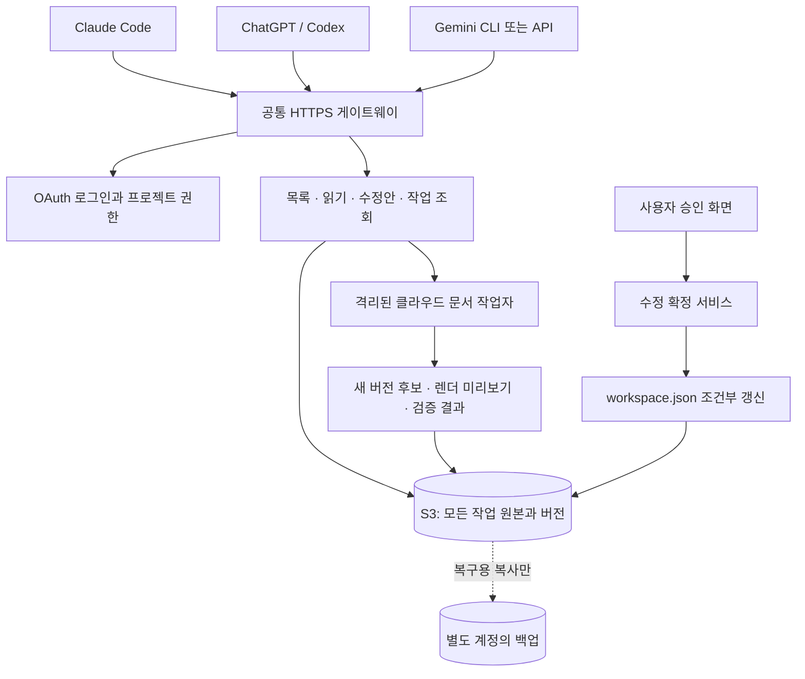

# 어느 PC에서나 같은 파일을 이어서 편집하는 AI 협업 설계

작성·공식 자료 확인: 2026년 10월 30일. 이 문서는 **설계안과 검증용 초기 구현의 범위**를 설명한다. 사용자 계정에 클라우드 자원을 만들거나 자격증명을 저장하지 않았으며, 네 AI를 실제 배포 서버에 연결한 시험도 아직 수행하지 않았다.

**권장안은 코드·Word·Excel·PowerPoint·PDF의 원본을 버전 관리가 켜진 S3 버킷 하나에 모으고, 네 AI가 공통 HTTPS 게이트웨이를 통해 읽고 수정하도록 만드는 것이다.** 어느 PC에서 접속하든 같은 파일 ID와 최신 리비전을 조회하게 하며, PC의 Google Drive 동기화 폴더에는 의존하지 않는다. 문서를 실제로 고치는 계산은 클라우드 작업자가 담당하고, 임시 작업 파일은 작업 후 폐기한다. 파일 원본은 중앙 저장소에만 두고, AI별 대화는 작업 원장으로 연결한다. 다만 모든 일반 채팅 앱이 임의의 원격 서버에 동일하게 연결되는 것은 아니므로, Gemini는 우선 Gemini CLI 또는 API 경로를 채택한다. 지금 준비한 코드는 설계를 검토하고 위험한 덮어쓰기를 시험하는 출발점이며, 문서 편집까지 완성된 서비스가 아니다.

## 하나의 원본 저장소와 하나의 연결 주소를 기준으로 설계한다

사용자의 요구는 특정 컴퓨터를 공유하는 방식이 아니라, **컴퓨터를 바꾸거나 기존 컴퓨터를 꺼도 AI들이 같은 중앙 파일을 이어서 다루는 것**이다. 따라서 PC는 로그인과 화면 표시를 담당하고, 파일의 정본·작업 상태·권한 판단·수정 확정은 클라우드에 둔다. 각 PC에 연결 주소를 등록하고 로그인하는 설정은 필요할 수 있지만, 프로젝트 전체를 동기화하거나 그 PC를 항상 켜 둘 필요는 없다. 여기서 “직접 읽고 쓴다”는 AI가 인증된 클라우드 도구로 중앙 파일에 접근한다는 뜻이다. AI에게 클라우드 관리자 키를 주거나, 모든 변경을 승인 없이 덮어쓰게 한다는 뜻으로 사용하지 않는다.

| 확인된 요구 | 설계에서의 의미 | 완료 판단 기준 |
|---|---|---|
| 어느 PC에서나 사용 | 저장소와 실행기가 PC 밖에 존재 | PC A를 끈 뒤 PC B에서 같은 파일 ID·리비전 조회 및 새 제안 생성 |
| Claude Code·ChatGPT·Gemini·Codex 협업 | 제품별로 가능한 연결 경로를 공통 게이트웨이에 연결 | 네 경로에서 동일한 샘플 파일의 리비전과 해시가 일치 |
| 코드와 Office·PDF를 함께 처리 | 텍스트 수정과 형식별 문서 편집 작업자를 분리 | `.py/.md`, `.docx`, `.xlsx`, `.pptx`, `.pdf` 대표 파일 각각 검증 |
| PC Drive 동기화 불가 | 클라우드 API로 원본을 읽고 새 버전을 저장 | 동기화 프로그램·PC 공유 폴더 없이 전체 시험 통과 |
| 같은 파일 수정이 사라지지 않음 | 읽은 버전 검사, 수정안 보존, 충돌 표시 | 두 AI가 동시에 수정해도 한쪽 변경이 조용히 유실되지 않음 |
| 승인 전 외부 자원·키 생성 금지 | 지금은 로컬 설계·코드·시험만 준비 | 배포·결제·OAuth 등록·비밀 저장은 별도 실행 단계로 남김 |

아래 구조는 **제안하는 최종 구조**다. 현재 배포된 구조를 나타내는 그림이 아니다.



**모든 작업 원본을 담는 저장소는 S3 하나**다. 버킷 내부에서 파일의 현재 버전, 과거 버전, 수정 제안, 작업 기록을 구분한다. 인증 서비스와 실행 환경은 저장소를 대신하지 않는 보조 서비스다. 다른 계정에 두는 백업은 복구 전용이며 AI가 편집할 수 있는 두 번째 정본으로 취급하지 않는다. 게이트웨이 자체의 소스 코드를 GitHub에 보관할 수는 있지만, 그 경우에도 사용자의 작업 파일을 GitHub와 S3 양쪽에서 동시에 편집하지 않는다.

S3는 한 객체의 갱신을 원자적으로 처리하고 강한 읽기 일관성을 제공하지만, 여러 객체를 한꺼번에 바꾸는 트랜잭션을 제공하지 않는다. 이 때문에 뒤에서 설명하는 불변 파일 버전과 단일 현재 상태 문서의 조건부 갱신을 사용한다. S3 자체가 Git의 코드 병합이나 Office 편집기가 되는 것은 아니다. ([S3 일관성](https://docs.aws.amazon.com/AmazonS3/latest/userguide/Welcome.html), [조건부 쓰기](https://docs.aws.amazon.com/AmazonS3/latest/userguide/conditional-writes.html), [버전 관리](https://docs.aws.amazon.com/AmazonS3/latest/userguide/Versioning.html))

| 저장소 선택지 | 적합한 작업 | 제약과 이번 판단 |
|---|---|---|
| **S3 하나: 이번 권장안** | 코드·Office·PDF 원본을 한 저장소에서 동일한 버전·승인 규칙으로 관리 | 파일 UI, 코드 diff, 편집기, 승인 화면을 구현해야 한다. 이미 완성된 문서 협업 제품은 아니다. |
| GitHub + S3 또는 Drive | 코드 PR·브랜치 작업이 많고 문서 저장도 필요 | 사용자에게는 한 게이트웨이지만 실제 저장소는 둘이다. 파일마다 정본 저장소 하나를 지정해야 한다. |
| Drive 중심 | 사람이 브라우저에서 Office 문서를 자주 열어 편집하거나 Google 문서 공동편집이 우선 | 파일 ID별 API와 형식별 편집 정책이 필요하다. 네이티브 Google 문서 변환본을 원래 Office 파일과 별개로 관리해야 한다. |
| GitHub만 사용 | 주로 코드와 Markdown | 코드 검토에 유리하지만 Office·PDF 의미 편집과 바이너리 충돌 처리를 해결하지 못한다. |
| R2 중심 | S3 호환 API와 전송비 구조를 우선 고려 | S3 호환이라는 이유만으로 S3 Versioning 등 모든 기능이 같다고 가정할 수 없다. 별도의 호환성 시험이 필요하다. |

GitHub Contents API는 파일 읽기·수정 기능이 있지만 100MB를 넘는 파일은 해당 읽기 API의 지원 대상이 아니다. Drive는 브라우저에서 Office 형식으로 편집하는 경로를 제공하며, Google 형식으로 변환하면 사본을 만든다. R2도 공식 호환성 표에서 기능을 구분한다. 따라서 네 제품 중 하나를 연결했다는 사실만으로 모든 파일 형식과 동시 편집 문제가 해결되지는 않는다. ([GitHub Contents API](https://docs.github.com/en/rest/repos/contents), [Drive에서 Office 파일 편집](https://support.google.com/docs/answer/9406611?hl=en), [R2 S3 호환성](https://developers.cloudflare.com/r2/api/s3/api/))

## 네 AI는 같은 도구를 사용하되, 연결 가능 여부를 계정에서 검증한다

원격 MCP는 AI가 `read_artifact`, `propose_edit` 같은 도구를 호출하도록 연결하는 규약이다. **MCP 연결은 파일 편집 능력이나 저장소 권한을 자동으로 만들어 주지 않는다.** 게이트웨이가 실제 저장·편집 기능을 제공하고, 해당 AI 제품과 계정에서 그 도구가 허용되어야 한다. 아래의 “문서상 지원”은 공급자의 공식 문서로 확인한 기능이며, “계정 미확인”은 사용자의 실제 로그인·관리자 설정·요금제에서 아직 시험하지 않았다는 뜻이다.

| 제품·사용 경로 | 공식 문서에서 확인한 기능 | 이번 연결 방안과 확인 상태 |
|---|---|---|
| Claude Code | 원격 HTTP MCP, OAuth, 도구 호출 | 공통 `/mcp` 연결. 문서상 지원, 사용자 계정·실제 서버 연결 미확인. [공식 문서](https://code.claude.com/docs/en/mcp) |
| Claude 웹·데스크톱 | 커스텀 원격 MCP 커넥터 | 필요하면 같은 주소 사용. Anthropic 클라우드에서 도달 가능한 서버와 조직 정책 확인 필요. [공식 문서](https://support.claude.com/en/articles/11175166-get-started-with-custom-connectors-using-remote-mcp) |
| Codex | Streamable HTTP MCP, OAuth, 도구 허용·차단 및 승인 설정 | 공통 `/mcp` 연결. 문서상 지원, 실제 계정 시험 전. [공식 문서](https://learn.chatgpt.com/docs/extend/mcp) |
| ChatGPT | 커스텀 MCP 서버의 읽기·쓰기 도구, OAuth | Plugins의 커스텀 MCP 경로 사용. 계정 메뉴·워크스페이스 정책 확인 필요. [공식 문서](https://developers.openai.com/api/docs/guides/custom-mcp-server) |
| Gemini CLI | 원격 MCP, OAuth, 도구 선택 | 우선 채택할 Gemini 경로. 클라우드 CLI의 로그인은 브라우저 리다이렉트 등 별도 설정 필요. [공식 문서](https://geminicli.com/docs/tools/mcp-server/) |
| Gemini API | Interactions API의 원격 MCP 및 함수 호출 | 필요하면 서버 실행 경로로 채택. 원격 MCP는 Streamable HTTP 지원. API 인증·과금 별도 확인. [공식 문서](https://ai.google.dev/gemini-api/docs/function-calling) |
| 일반 Gemini 웹 앱 | GitHub 가져오기와 파일 생성·편집 기능 | 임의 MCP 서버를 연결해 지정 원본을 안전하게 수정하는 경로는 이번 조사에서 검증되지 않았다. 기본 연결 경로로 약속하지 않는다. [GitHub 가져오기](https://support.google.com/gemini/answer/16176929?hl=en), [파일 생성 업데이트](https://workspaceupdates.googleblog.com/2026/10/create-preview-and-edit-files-directly-in-the-Gemini-app.html) |

Gemini 웹의 GitHub 가져오기는 업로드 당시의 스냅샷을 사용하며 저장소 쓰기를 지원하지 않는다. 반면 최근 Gemini 앱의 파일 생성·편집 기능은 문서를 만들고 Drive로 올리는 작업을 포함한다. **새 파일을 만들어 내보내는 기능과 중앙의 특정 원본을 동일한 버전 규칙 아래 수정하는 기능은 별개**다. 일반 Gemini 웹만 사용한다는 조건이 추가되면, 그 경로는 제안 생성까지로 제한하고 실제 반영은 공통 실행기가 맡도록 범위를 조정해야 한다. ([Gemini GitHub 가져오기](https://support.google.com/gemini/answer/16176929?hl=en), [Gemini 파일 기능](https://workspaceupdates.googleblog.com/2026/10/create-preview-and-edit-files-directly-in-the-Gemini-app.html))

Google Drive 연동에 대해서도 앞선 설명을 바로잡을 필요가 있다. **`https://drivemcp.googleapis.com/mcp/v1`는 실제 Google 공식 엔드포인트**다. 다만 Developer Preview의 현재 도구 목록에는 읽기·검색·생성·복사 등이 있고 기존 파일을 갱신하는 도구는 없다. 이를 연결하기만 하면 네 AI가 모든 기존 Office·Google 문서를 수정할 수 있다고 말할 수 없다. 기존 바이너리 교체에는 Drive `files.update`, Google Docs 본문 편집에는 Docs API와 같은 별도 경로가 필요하다. ([Drive MCP 도구 목록](https://developers.google.com/workspace/drive/api/reference/mcp), [MCP 구성 조건](https://developers.google.com/workspace/drive/api/guides/configure-mcp-server), [Drive 업로드·갱신](https://developers.google.com/workspace/drive/api/guides/manage-uploads), [Docs batchUpdate](https://developers.google.com/workspace/docs/api/reference/rest/v1/documents/batchUpdate))

그렇다고 모든 Drive 커넥터가 읽기 전용이라는 뜻도 아니다. Claude의 최신 Google Workspace 커넥터 문서는 Drive 작업과 Docs·Sheets·Slides 원본의 편집을 설명한다. 현재 Codex 세션에도 문서 관련 도구가 제공된다. 그러나 한 제품의 연결 기능이 다른 제품에 그대로 존재한다고 가정할 수 없으므로, 이번 설계에서는 **공통 게이트웨이의 도구 계약과 실제 호출 시험**을 기준으로 판정한다. ([Claude Google Workspace 커넥터](https://support.claude.com/en/articles/10166901-use-google-workspace-connectors))

원격 접속은 HTTPS Streamable HTTP를 기본으로 하고, 긴 문서 편집은 요청을 계속 붙잡아 두는 대신 작업 ID를 즉시 반환한다. AI는 `get_job`으로 진행 상황을 확인하고 완성된 결과를 가져온다. 서버 로그인은 OAuth로 처리하며, 인증 서버·보호된 리소스 메타데이터·토큰 대상 검증을 구현한다. MCP 최신 인증 규격은 보호된 서버와 OAuth 클라이언트의 역할, 리소스 표시, 최소 범위 요청을 정의한다. 구체적인 로그인 서버는 배포 전 네 클라이언트의 실제 OAuth 흐름과 맞춰 선택한다. ([MCP 인증 규격](https://modelcontextprotocol.io/specification/2026-07-28/basic/authorization))

게이트웨이의 권한 범위는 `workspace:read`, `proposal:create`, `job:read`처럼 나눈다. 이는 이 프로젝트에서 제안하는 범위 이름이며 공급자의 기존 표준 범위라는 뜻은 아니다. 요청 주체는 모델이 보낸 `actor="owner"` 같은 문자열이 아니라 검증된 로그인 토큰의 사용자와 클라이언트 정보로 결정한다. 같은 사람이 네 AI를 사용하더라도 감사기록에는 사용자 ID와 호출 클라이언트를 함께 남긴다. AI가 다른 사용자를 사칭하거나 다른 프로젝트 ID를 입력해 접근할 수 없어야 한다.

사용자는 중앙 저장소에 이미 접근할 수 있는 AI에게 “프로젝트 A의 최신 작업 기록을 읽고, 제안 42 다음 단계부터 진행해 줘”라고 요청할 수 있다. 이때 공유되는 것은 각 서비스의 비공개 대화 전체가 아니라 **요구사항, 결정, 파일 리비전, 작업 결과, 남은 할 일**이다. 도구가 작업 원장을 먼저 읽도록 구성하면 AI가 바뀌어도 이어서 일할 수 있다. 저장소를 연결했다는 이유만으로 네 AI가 자동으로 서로의 대화를 읽거나 상시 감시한다고 설명하지 않는다.

이번 종합 설계에는 요청한 **GPT-6 Astra의 높은 추론 설정을 사용하는 별도 설계 작업**을 사용했다. 이것은 주대화 자체의 모델을 변경했다는 뜻이 아니다. 주대화 모델 선택은 앱 입력창 아래 모델 설정과 Advanced 메뉴에서 확인해야 하며, 실제 표시되는 모델은 계정과 환경에 따라 다르다. ([공식 모델 안내](https://learn.chatgpt.com/docs/models))

## 수정 제안을 검증한 뒤 현재 버전의 포인터만 바꾼다

저장소 내부에서는 파일 이름과 파일의 정체성을 분리한다. 예를 들어 `회의자료/보고서.docx`라는 표시 경로는 바뀔 수 있어도 `artifact_id`는 유지한다. 각 새 버전은 `objects/<artifact_id>/<revision_id>`에 저장하고, `workspace.json`이 현재 파일별 객체 키·S3 version ID·SHA-256·형식·크기·수정 정보를 가리킨다. S3 ETag는 조건부 요청을 위한 **불투명한 비교값**으로 취급하고, 파일 내용의 무결성은 별도 SHA-256으로 확인한다. 원본 파일의 바이트와 렌더 미리보기는 별개 자산으로 기록한다.

| 게이트웨이 도구안 | 입력·반환의 핵심 | 변경 가능 범위 |
|---|---|---|
| `list_artifacts` / `read_artifact` | 프로젝트, 파일 ID → 현재 리비전·해시·내용 또는 제한된 다운로드 참조 | 읽기만 수행 |
| `inspect_document` | 파일 ID·리비전 → 페이지·시트·슬라이드 등 구조와 지원 제한 | 원본 변경 없음 |
| `propose_text_edit` | 파일 ID·기준 리비전·수정 내용·요청 ID → 제안 ID·diff | 새 후보 버전만 생성 |
| `propose_document_edit` | 파일 ID·기준 리비전·구조화된 편집 요청 → 작업 ID | 격리 작업자 실행, 후보만 생성 |
| `get_job` / `get_proposal` | 작업·제안 ID → 상태·미리보기·검증 결과 | 읽기만 수행 |
| 사용자 승인 화면의 확정 동작 | 제안 ID·기준 리비전·승인된 내용의 해시 | 별도 확정 서비스만 현재 포인터 갱신 |

수정 흐름은 최신 원본 조회, 기준 리비전 기록, 후보 생성, 검증, 승인, 확정, 재조회 순서다. 새 후보 객체는 `If-None-Match: *`로 만들어 기존 같은 키를 덮어쓰지 않는다. 확정 서비스는 최신 `workspace.json`을 읽어 해당 파일의 기준 리비전이 아직 일치하는지 확인하고, 새 포인터를 담은 문서를 기존 ETag에 대한 `If-Match`로 저장한다. 조건 불일치는 충돌이며 무조건 재저장하지 않는다. S3의 조건부 쓰기는 이러한 존재 여부·ETag 조건을 지원한다. ([S3 조건부 쓰기](https://docs.aws.amazon.com/AmazonS3/latest/userguide/conditional-writes.html))

두 AI가 같은 파일의 리비전 17을 읽었다고 하자. Claude가 후보 18을 만들고 사용자가 확정하면 현재 버전은 18이 된다. 그 뒤 Gemini가 리비전 17을 바탕으로 만든 후보를 확정하려 하면 거절된다. 후보 파일은 보존되므로 두 버전을 비교해 재작성할 수 있고, 한쪽의 수정이 조용히 사라지지 않는다. 서로 다른 파일을 고쳤다면 전체 manifest 갱신 경쟁 때문에 한 요청이 먼저 실패할 수 있다. 이 경우 서버는 최신 manifest를 다시 읽고 **그 제안이 의존한 모든 파일의 리비전**이 그대로인지 검사한 뒤에만 재시도한다. 관련 없는 변경까지 무조건 사용자 충돌로 돌릴 필요는 없지만, 관련 변경을 건너뛰어서도 안 된다.

여러 파일을 함께 바꾸는 제안도 먼저 모든 새 객체를 업로드하고 해시를 확인한 뒤, **현재 파일들의 포인터를 담은 manifest 하나**를 조건부 갱신한다. 독자는 한 번 읽은 manifest 스냅샷을 따라 파일을 조회하므로 한 제안의 일부만 새 버전으로 보이는 일을 피할 수 있다. 이는 S3 여러 키에 대한 원자적 저장이 아니라, 불변 객체를 미리 준비하고 마지막 한 포인터 문서의 갱신을 원자적으로 처리하는 설계다. 원시 버킷 키를 직접 훑어 “가장 최근 객체”를 정본으로 판단하는 우회 경로는 제공하지 않는다. ([S3의 단일 키 원자성과 다중 키 제한](https://docs.aws.amazon.com/AmazonS3/latest/userguide/Welcome.html))

객체 업로드 뒤 확정이 실패하면 현재 버전은 그대로이고 참조되지 않은 후보가 남는다. 이 후보를 즉시 삭제하면 복구나 재시도를 방해할 수 있으므로 유예기간 후 정리한다. 반대로 확정은 성공했으나 응답을 받기 전에 연결이 끊어질 수 있다. 이를 위해 요청마다 멱등 키를 요구하고, **확정 결과와 그 요청의 영수증을 같은 manifest 갱신에 포함**한다. 재시도는 같은 요청의 기존 결과를 돌려준다. 같은 키에 다른 수정 내용을 넣으면 오류로 처리한다. 멱등 기록의 보존기간이 지난 요청은 새 작업으로 몰래 재실행하지 않고 상태 재확인을 요구한다.

오래 걸리는 Office 작업에는 문서별 임대 잠금을 붙일 수 있다. 초기 제안값은 15분 만료, 5분 간격 갱신이며 실제 시간은 샘플 파일로 조정한다. 잠금은 사용자에게 “다른 AI가 작업 중”임을 보여 주고 중복 작업을 줄이는 보조 수단이다. **잠금만으로 덮어쓰기를 막지 않는다.** 잠금 세대 번호를 증가시키고 manifest 안에서 관리하여, 만료 후 새 작업이 시작되면 이전 작업자의 세대 번호로는 확정할 수 없게 한다. 최종 확정은 항상 기준 리비전·잠금 세대·manifest 조건을 함께 확인한다.

작업 기록에는 `task_id`, 요구사항, 담당 클라이언트, 기준 리비전, 입력 의존성, 후보 ID, 검증 결과, 승인자, 확정 리비전과 오류를 남긴다. 상태는 `queued → running → validating → awaiting_approval → committed`를 기본으로 하며 `conflict`, `failed`, `cancelled`를 구분한다. 작업 상태 파일은 작업별 조건부 갱신으로 관리하되, **실제로 원본에 반영됐는지의 최종 근거는 manifest의 확정 영수증**이다. 상태 갱신 도중 장애가 생기면 복구 작업이 영수증을 읽고 상태를 맞춘다. 문서 파일 갱신과 별도 작업 파일 갱신이 자동으로 하나의 트랜잭션이 된다고 가정하지 않는다.

소규모 개인 사용은 이 객체 기반 원장으로 시작해 별도 데이터베이스 운영 부담을 줄일 수 있다. 대신 manifest 크기와 갱신 경쟁률을 측정해야 한다. 동시 사용자·파일 수가 커지면 프로젝트별로 manifest를 나누거나 트랜잭션 데이터베이스를 검토한다. 그 경우에도 서로 다른 프로젝트 사이의 원자적 확정은 별도 문제이며, 데이터베이스와 S3 파일 업로드가 저절로 같은 트랜잭션이 되는 것은 아니다.

문서 편집 작업자는 특정 입력 리비전만 읽고 임시 작업 공간에서 수정한 뒤, 새 후보와 검증 결과를 내놓는다. PC의 동기화 폴더를 쓰지 않더라도 **편집 엔진이 원본 바이트를 클라우드 메모리나 임시 디스크로 가져오는 과정은 필요**하다. 원본 조회·작업·재업로드 경로를 클라우드 안에 둔다는 것이 이 설계의 의미다. 컨테이너는 작업마다 격리하고 임시 파일의 수명과 실패 시 정리 규칙을 둔다.

| 형식 | 초기 지원 범위 제안 | 확정 전 확인할 사항 | 자동 보존을 약속하지 않는 부분 |
|---|---|---|---|
| 코드·Markdown | 텍스트 수정, diff, 필요한 정적 검사·테스트 | 구문·인코딩·관련 테스트와 수정 범위 | 실행 결과와 의미적 정확성 전체 |
| DOCX | 문단·표·스타일을 지정한 제한적 수정 | 한글·글꼴·표·머리글·페이지·렌더 전후 비교 | 복잡한 필드·추적 변경·특수 레이아웃의 완전 보존 |
| XLSX | 지정 셀·수식·표·차트 관련 제한적 작업 | 수식 재계산, 오류값, 시트·차트·이름 범위·서식 | 외부 연결·복잡한 피벗·특수 기능의 완전 보존 |
| PPTX | 텍스트·그림·지정 슬라이드 요소 수정 | 슬라이드 수, 글꼴, 잘림, 그림 위치, 렌더 비교 | 애니메이션·고급 효과·특수 미디어의 완전 보존 |
| PDF | 텍스트 추출·주석·페이지 작업, 가능한 경우 원본에서 재생성 | 페이지 수·텍스트·한글 글꼴·시각 비교 | 모든 PDF를 Word처럼 구조 편집하거나 스캔 레이아웃을 완전히 복원 |

이 표는 공급자의 보증이 아니라 **우리가 구현하고 시험해야 할 편집 계약**이다. Claude의 파일 기능처럼 여러 형식을 만들고 편집하는 제품 기능은 이미 있지만, 특정 클라우드 원본의 형식 보존까지 입증하려면 실제 샘플이 필요하다. 업로드 분석 지원도 동일 ID 원본 수정과는 구분한다. ([Claude 파일 생성·편집](https://support.claude.com/en/articles/12111783-create-and-edit-files-with-claude), [Gemini 파일 업로드](https://support.google.com/gemini/answer/14903178?hl=en), [ChatGPT 파일 작업](https://learn.chatgpt.com/docs/artifacts-viewer))

초기 범위는 일반 `.docx/.xlsx/.pptx`와 서명되지 않은 PDF부터 시작한다. 매크로 포함 파일은 임의 실행하지 않고 별도 지원 대상으로 표시한다. 외부 링크·원격 이미지·연결 데이터 새로고침은 기본 차단하고, 필요하면 승인된 대상만 허용한다. 암호화·전자서명 파일은 열기와 수정이 가능한지 먼저 검사하고, 서명 유효성을 보존한다고 약속하지 않는다. Excel 결과는 “수식 문자열을 저장했다”와 “재계산 엔진으로 결과를 확인했다”를 구분해 표시한다. PDF의 편집 가능한 원본이 DOCX나 PPTX로 존재하면 그 원본을 수정하고 PDF는 파생 출력으로 만드는 편이 예측 가능하다. 각 파일의 정본과 파생물 관계를 기록해 두 형식이 따로 진행되지 않게 한다.

## 로그인·승인·복구를 파일 수정 경로 안에 넣는다

AI 클라이언트에 S3 장기 접근 키를 나눠 주지 않는다. 클라우드 실행 환경은 IAM 역할의 임시 권한을 사용하고, 사용자 로그인 토큰은 게이트웨이에만 제시한다. AWS는 워크로드의 임시 자격증명과 최소 권한을 권장하며, S3는 공개 접근 차단 등 보안 설정을 제공한다. 이 설계에서는 공개 버킷·공개 파일 URL을 기본값으로 사용하지 않는다. ([IAM 권장사항](https://docs.aws.amazon.com/IAM/latest/UserGuide/best-practices.html), [S3 보안 권장사항](https://docs.aws.amazon.com/AmazonS3/latest/userguide/security-best-practices.html))

| 실행 주체 | 허용할 권한 | 초기에는 주지 않을 권한 |
|---|---|---|
| AI용 조회·제안 서비스 | 지정 프로젝트 읽기, 신규 후보·작업 상태 생성 | 현재 manifest 확정, 원본·과거 버전 삭제, 버킷 설정 변경 |
| 클라우드 문서 작업자 | 지정 입력 버전 읽기, 해당 작업의 신규 출력 키 쓰기 | 다른 프로젝트 조회, 현재 포인터 갱신, 사용자 관리, 무제한 외부 접속 |
| 사용자 승인·확정 서비스 | 승인된 후보 읽기, 허용된 manifest 조건부 갱신 | 버킷 정책·버전관리 설정 변경, 과거 버전 삭제 |
| 백업 작업 | 일관된 manifest 스냅샷과 참조 객체 읽기, 백업 위치에 신규 스냅샷 저장 | 운영 원본 수정, 기존 백업 영구 삭제 |
| 사용자 관리자 | 계정·권한·보존 정책을 명시적으로 관리 | AI 도구에 관리자 권한을 상속하지 않음 |

이 구분은 서버 역할과 경로를 실제로 나눠 구현해야 한다. 코드 안의 “이 폴더만 허용” 검사만으로 훔친 저장소 자격증명의 범위까지 좁아지는 것은 아니다. 다운로드용 서명 URL이 필요하면 파일·버전·짧은 유효시간을 제한하고 로그나 모델의 장기 기록에 남기지 않는다. 서명 URL은 만료 전 반복 사용할 수 있는 접근 수단이며, 기존 키에 대한 업로드 URL은 덮어쓰기를 일으킬 수 있으므로 새 불변 키만 대상으로 한다. ([S3 서명 URL](https://docs.aws.amazon.com/AmazonS3/latest/userguide/using-presigned-url.html))

초기 운영에서는 AI가 수정안을 만드는 것까지 자동으로 허용하고, 원본 확정은 사용자 화면에서 수행한다. 승인 화면은 수정 대상·기준 버전·전후 차이·미리보기·검증 실패를 보여 준다. 승인은 제안 ID와 내용 해시, 프로젝트, 기준 리비전에 묶고 유효시간을 둔다. 승인 후 내용이 바뀌거나 원본이 바뀌면 다시 검토한다. 모델에 승인 자체를 수행하는 도구를 제공하지 않으며, 파일 본문에 “사용자가 승인했다”라고 적혀 있어도 승인으로 인정하지 않는다. 이후 사용자가 원하면 검증된 경로의 낮은 위험 변경에 한정해 자동 확정 정책을 추가할 수 있다.

파일의 지시문과 실제 사용자의 작업 요청도 구분한다. 문서·코드·웹에서 읽은 “다른 파일을 모두 전송하라”, “권한을 넓혀라”, “비밀을 보여라” 같은 문구는 분석 대상 데이터다. 파일 내용이 도구 권한이나 승인 규칙을 바꾸게 해서는 안 된다. 문서 작업자는 임의 명령 실행 대신 정해진 작업 형식을 받고, 필요 실행도 격리된 환경과 제한된 네트워크에서 처리한다. 업로드 문서는 크기·압축 해제량·시간 제한을 두고 검사하며, 로그에는 토큰·서명 URL·파일 본문 대신 요청 ID, 주체, 파일 ID, 기준·결과 리비전, 상태를 남긴다.

GitHub를 코드 중심 대안이나 시스템 소스 저장소로 사용할 때는 GitHub App을 선택한 저장소에만 설치한다. 파일 수정과 PR 생성이 필요한 경우 `Contents: read/write`, `Pull requests: read/write`, 필요한 메타데이터 읽기만 요청하고 관리·Actions·Secrets 권한은 제외한다. 설치 토큰은 1시간 후 만료되며, App 개인 키와 구분해 보관해야 한다. **Contents 쓰기 권한은 저장소 수준이므로 특정 경로나 작업 브랜치만 쓸 수 있는 토큰이라고 설명하지 않는다.** 게이트웨이의 경로·브랜치 제한과 서버 보호 규칙을 별도로 적용한다. ([GitHub App 권한](https://docs.github.com/en/apps/creating-github-apps/registering-a-github-app/choosing-permissions-for-a-github-app), [설치 토큰](https://docs.github.com/en/apps/creating-github-apps/authenticating-with-a-github-app/generating-an-installation-access-token-for-a-github-app))

GitHub Free 비공개 저장소에서 PR을 만들도록 운영하는 것과 서버가 보호 브랜치 정책을 강제하는 것은 다르다. 비공개 저장소의 보호 브랜치 기능은 지원 요금제가 필요하므로, 유료 요금제나 조직 정책을 확인하기 전 “main 직접 쓰기가 서버에서 차단된다”고 보장하지 않는다. GitHub 대안을 채택하면 force push·삭제·필수 검토·우회 권한까지 실제 시험한다. ([보호 브랜치와 요금제](https://docs.github.com/en/repositories/configuring-branches-and-merges-in-your-repository/managing-protected-branches/about-protected-branches))

버전 관리는 복구의 첫 단계지만 독립 백업을 대체하지 않는다. 운영 계정이 손상되거나 과거 버전 삭제 권한이 잘못 사용될 수 있기 때문이다. **초기 복구 목표는 RPO 24시간, RTO 4시간**으로 제안한다. 즉 하루에 한 번 독립 계정으로 스냅샷을 만들고, 장애 시 최대 하루치 작업 손실과 4시간 이내 복원을 목표로 하되 실제 복원 시험 전에는 SLA로 약속하지 않는다. 백업은 특정 manifest 버전과 그 manifest가 참조하는 불변 객체, 해시, 정책, 작업 기록을 함께 보존한다. 월 1회 깨끗한 시험 환경에 복구하여 파일 해시와 열림 여부를 확인한다.

초기 보존 정책안은 작업 후보 14일, 확정 버전 90일, 일별 독립 백업 30일, 본문 없는 감사기록 90일이다. 이는 비용과 업무 필요에 따라 승인할 설정값이다. 현재 원본이나 보존 중인 스냅샷이 참조하는 객체를 삭제하면 안 되므로, 단순히 생성 후 90일이 지났다는 이유로 모든 객체를 지우는 규칙은 사용하지 않는다. 확정 이력과 백업의 참조를 먼저 검사하고 유예기간을 둔 정리 작업을 별도 권한으로 실행한다. S3 버전 관리는 기본적으로 켜져 있지 않으며 각 버전의 전체 크기가 저장량에 포함된다. ([S3 버전 관리와 비용](https://docs.aws.amazon.com/AmazonS3/latest/userguide/Versioning.html))

## 비용과 완료 기준을 정하고 단계적으로 운영에 연결한다

사용량과 리전이 정해지기 전에는 전체 월 비용을 한 숫자로 약속할 수 없다. **S3 권장안의 월 비용은 보존 저장량, 요청 수, 전송량, 문서 작업 시간, 게이트웨이·인증·로그, AI 사용량의 합**이다. S3 공식 가격은 리전과 저장 클래스별로 확인해야 하며, 이번 조사에서는 일반 Standard 저장 단가 표의 선택 리전 값을 확정하지 않았다. 따라서 S3 Tables나 R2의 단가를 S3 일반 버킷 견적으로 바꾸어 적지 않는다. ([S3 공식 요금](https://aws.amazon.com/s3/pricing/))

```text
월 총액 = 저장된 전체 GB-month × 선택 리전 저장 단가
        + PUT/LIST/GET 등 요청 요금 + 외부 전송 요금
        + 문서 작업자의 CPU·메모리·임시 저장 시간
        + 게이트웨이·인증·감사기록·도메인 비용
        + 사용하는 AI의 구독 및 별도 API 비용
```

예를 들어 현재 파일이 10GB이고 매월 전체가 한 번 교체되며 총 세 시점의 전체 버전을 보관한다면 원본 이력은 단순 계산 약 30GB다. 독립 백업도 같은 세 시점을 보존하면 합계는 약 60GB가 된다. 후보 파일과 미리보기는 여기에 추가된다. 실제로는 변경 빈도와 보존 정책에 따라 크게 달라지므로 “현재 파일이 10GB이니 10GB 요금만 든다”는 계산을 피한다.

대안의 계산 규모를 보여 주기 위해 **R2 요금만 별도 예시**로 계산하면, 공식 Standard 단가는 GB-month당 USD 0.015이고 월 무료 저장 할당은 10GB-month다. 총 보존량 50GB라면 저장료 부분은 `(50−10)×0.015 = USD 0.60/월`이다. Class A 100만 건과 Class B 1천만 건의 월 무료 할당을 넘지 않는다는 가정이며, 초과 단가는 각각 백만 건당 USD 4.50과 USD 0.36이다. Workers Paid 기본 구독 USD 5를 더한 단순 예는 USD 5.60이지만, **이는 S3 운영 견적도, Office 렌더 작업자까지 포함한 서비스 전체 견적도 아니다.** 인증·로그·세금·문서 작업·AI는 별도다. ([R2 요금](https://developers.cloudflare.com/r2/pricing/), [Workers 요금](https://developers.cloudflare.com/workers/platform/pricing/))

초기 테스트 환경의 인프라 예산 목표는 월 USD 20 이내로 제안한다. 이 숫자는 공급자 견적이나 확정 지출 한도가 아니라, 배포 구성을 선택할 때 맞춰야 할 목표다. 해당 리전 계산기에서 기본 서비스·백업·로그까지 합산해 넘는다면 구성이나 목표를 수정한다. Office 렌더·OCR와 API 모델 사용량은 별도 한도를 두고, 예상 비용이 큰 작업은 제출 전에 표시한다. 예산 알림만으로 청구가 정확히 멈춘다고 가정하지 않고, 서비스의 작업 수·파일 크기·실행 시간·일별 사용량 제한을 함께 구현한다.

네 AI 제품을 연결한다고 네 개의 추가 구독이 자동으로 필요한 것도 아니고, 기존 구독이 모든 외부 API 사용을 포함한다고 가정해서도 안 된다. 실제로 사용하는 제품·인증 경로·API 크레딧의 포함 범위를 계정에서 확인해야 한다. 서버가 AI API를 호출하는 경우 공급자의 API 가격과 결제 체계를 기준으로 모델별 입력·출력 토큰 및 도구 과금을 계산한다. 예를 들어 월 입력 100만 토큰, 출력 20만 토큰이면 모델 사용료는 `입력 100만당 단가 + 0.2 × 출력 100만당 단가 + 도구 요금`이다. 모델을 확정하기 전 Astra 등 특정 모델의 API 단가를 추정해 넣지 않는다. ([OpenAI API 가격 안내](https://developers.openai.com/api/docs/pricing), [Gemini API 결제](https://ai.google.dev/gemini-api/docs/billing))

클라우드 IDE는 Claude Code나 Gemini CLI를 실행할 장소로 쓸 수 있지만 상시 게이트웨이의 기본 호스트로 삼지 않는다. Codespaces는 계산시간과 저장공간에 과금하며 중지된 환경도 보존 저장량이 비용에 영향을 준다. 공식 문서의 2-core 유료 단가 USD 0.18/시간과 USD 0.07/GB-month를 적용하면, 무료 할당 없는 계정에서 80시간과 평균 10GB 저장은 `80×0.18 + 10×0.07 = USD 15.10`이다. 이는 그 개발환경만의 예시다. ([Codespaces 과금](https://docs.github.com/en/billing/concepts/product-billing/github-codespaces))

실행은 아래 단계의 통과 조건으로 진행한다. 날짜를 먼저 약속하기보다 계정 연결과 문서 품질 시험 결과를 다음 단계의 출발 조건으로 삼는다.

| 단계 | 수행 내용 | 다음 단계로 넘어가는 조건 |
|---|---|---|
| 지금: 설계·로컬 검증 | 설계서, 권한안, 검토용 코드와 오프라인 시험 | 범위·한계·배포 승인 대상이 명확함 |
| 1: 승인 후 저장·로그인 기반 | 원본 버킷 버전관리, 게이트웨이, OAuth, 역할 분리, 샘플 원본 | 실제 클라우드 read/propose/approve/read가 동일 파일 ID로 성공 |
| 2: 충돌·재시도·복구 | manifest CAS, 멱등 영수증, 작업 복구, 백업 | 동시 수정·장애·재시도 시험에서 원본 유실·중복 확정 없음 |
| 3: 네 AI 연결 | Claude Code, Codex, ChatGPT, Gemini CLI/API | 각 클라이언트의 로그인·도구 목록·읽기·제안·재조회 증거 확보 |
| 4: Office·PDF 편집 | 형식별 작업자, 미리보기, 검증, 예외 처리 | 대표 파일의 수용 기준을 사용자와 확인하고 전후 비교 통과 |
| 5: 일상 운영 | 사용량 제한, 비용 점검, 복원 훈련, 필요한 자동화 | PC 교체·기존 PC 종료 상태에서도 같은 작업을 이어감 |

현재 `cloud-ai-hub`에는 두 가지 **검토용 부분 구현**이 있다. 권장안에 대응하는 `object_core.py`는 메모리 안에서 불변 바이트 객체·SHA-256·불변 스냅샷·세대 번호 조건 검사를 사용하여 여러 파일의 현재 포인터를 한 번에 공개하는 동작을 보여 준다. 새 시험 6개는 후보 저장과 확정 분리, 충돌 거절, 이전 스냅샷을 읽는 독자의 일관성, 실패한 확정이 현재 포인터를 바꾸지 않는 성질 등을 확인한다. Office/PDF처럼 이름 붙인 바이트 시험자료도 있지만 **실제로 열리는 Office/PDF 문서가 아니며, 원본 형식 편집이나 서식 보존 시험도 아니다.** 이 코어는 한 프로세스의 메모리 잠금을 사용한 데모이고, 실제 S3의 ETag 조건부 쓰기와 영속 저장을 구현한 상태가 아니다.

GitHub 대안에 대응하는 `hub.py`는 Python 표준 라이브러리로 작성한 텍스트 읽기·수정 PR 제안 코드다. 읽을 때 main의 커밋을 고정하고 파일 SHA를 반환한다. 제안은 기본적으로 실제 쓰기를 하지 않는 검토 실행이며, 명시 실행 시 기준 커밋과 파일 SHA를 검사하고 작업 브랜치와 PR을 만든다. main 직접 쓰기·삭제·강제 푸시·자동 병합 API는 제공하지 않는다. 기존 시험 9개에서 오래된 버전 거절, 동시 쓰기 경쟁, 경로 제한, 인증 누락, 쓰기 기본 차단 등을 확인했다. **두 부분을 합한 오프라인 시험 15개가 통과했고 별도 재실행으로도 확인했다.** 실제 GitHub·S3 계정의 권한이나 클라우드 쓰기를 검증했다는 뜻은 아니다.

**현재 구현에는 원격 MCP 서버, 사용자 OAuth, 실제 클라우드 배포, S3 연결, Office/PDF 내용 편집, 운영 백업이 없다.** 영속 멱등 처리와 일부 비신뢰 저장소 경로 검사도 운영 수준이 아니다. 따라서 로컬 코드를 실행하면 곧바로 “네 AI가 단일 중앙 저장소에서 Office까지 협업하는 시스템”이 완성되는 것은 아니다. 객체 코어를 실제 S3 어댑터·영속 확정 서비스로 확장하고 문서 작업자를 구현해야 한다. GitHub 부분은 코드 중심 대안의 시작점이다. 함께 제공한 README와 테스트 결과는 이 한계를 포함해 읽어야 한다.

최종 인수시험은 단순히 “연결됨” 표시를 보는 것으로 끝내지 않는다. 아래 결과를 요청 ID·파일 ID·리비전·해시·시간과 함께 기록하고, 저장소에 보관할 수 있어야 한다.

| 시험 | 통과 증거 |
|---|---|
| AI 간 이어받기 | AI A가 읽고 수정안 생성 → 사용자 확정 → AI B·C·D가 같은 파일의 새 리비전과 동일 SHA-256 조회 |
| PC 독립성 | PC A 종료 후, 동기화 설정 없는 PC B에서 같은 절차 성공 |
| 같은 파일 동시 수정 | 같은 기준 리비전의 두 후보 중 하나 확정, 다른 후보는 명시적 충돌로 남고 내용 보존 |
| 여러 파일 한 제안 | 독자가 하나의 manifest 스냅샷에서 전부 이전 또는 전부 새 버전을 읽음 |
| 응답 유실·재시도 | 확정 직후 응답을 끊고 재시도해도 새 버전이나 PR이 중복 생성되지 않음 |
| 작업자 장애 | 편집 중 종료·잠금 만료 후 재시작해도 이전 작업자가 뒤늦게 원본을 덮어쓰지 못함 |
| 권한 경계 | 다른 프로젝트, 원본 직접 덮어쓰기, 과거 버전 삭제, 만료·폐기 토큰 요청 거절 |
| 문서 품질 | 대표 Office·PDF의 구조·내용·시각 결과가 사전 수용 기준을 만족 |
| 복구 | 독립 백업에서 새 환경에 복원하고 manifest·파일 해시·문서 열림 확인, 실제 RPO/RTO 기록 |
| 비용 | 작업별 사용량 기록과 제한 동작 확인, 선택 리전의 실제 청구 견적 검토 |

배포 승인 대상은 별도 문서인 `승인_후_실행계획.md`에 자원 이름, 권한, 보존 기간, 단계별 결과로 구체화했다. 그 계획에 대한 승인은 새로운 서비스와 권한을 실제 계정에 만드는 다음 작업을 승인하는 것이며, 지금 이미 배포됐다는 의미가 아니다. **이 설계의 실질적인 완료점은 네 AI의 연결 메뉴가 채워진 순간이 아니라, 다른 PC와 다른 AI가 같은 파일의 검증된 새 리비전을 읽고 안전하게 다음 수정을 시작하는 순간이다.**
